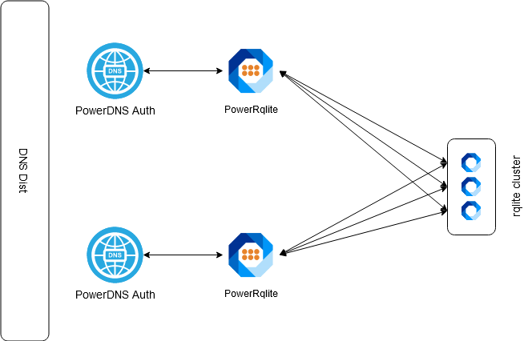

# PowerDNS backend for rqlite (distributed SQLite)

*PowerRqlite* is a small [PowerDNS Authoritative](https://powerdns.com) remote backend that stores zones and records in an [rqlite](https://github.com/rqlite/rqlite) cluster (distributed SQLite).
It lets you run a highly available PowerDNS setup without MySQL/MariaDB replication or a Galera cluster.


## How it works

*PowerRqlite* implements the required PowerDNS [remote backend functions](https://doc.powerdns.com/authoritative/backends/remote.html) and stores the data in the rqlite cluster using the [rqlite Data API](https://rqlite.io/docs/api/api/).

A simple deployment could look like this:


*PowerRqlite* can also be used to build a high availability (HA) DNS setup **without** the need for a (complex) MariaDB Galera cluster as HA backend:



## Prerequisites

* .NET 10 compatible Operating System (Ubuntu/Debian/CentOS/Alpine Linux/Windows/macOS) or a Docker Host
* [rqlite Cluster](https://rqlite.io/docs/clustering/)
* PowerDNS Authoritative 4.3.x or higher, including 5.x (tested with 4.9 and 5.1; see Known Issues for 5.x)

*PowerRqlite* can be used for the following DNS Modes of Operation:

| Name        | Native | Master | Slave | SuperSlave | DNSSEC | Launch |
|-------------|:------:|:------:|:-----:|:----------:|:------:|:------:|
| PowerRqlite |   yes  |   yes  |   no  |     no     |   no   | remote |


## Known Issues

* `pdnsutil delete-zone` and the PowerDNS Web API cannot delete a zone: the PowerDNS
  remote backend module never sends a zone-deletion method (upstream gap).
  Delete a zone through `pdnsutil backend-cmd` or the PowerRqlite extension endpoint instead:
  ```
  pdnsutil backend-cmd remote "delete-zone example.com"
  curl -X POST http://127.0.0.1:5000/PowerDns/deleteDomain/example.com.
  ```
* The remote backend module has no zone-creation method either, so PowerRqlite creates a zone
  the first time PowerDNS asks for its domain info (that is what makes `pdnsutil create-zone` work on PowerDNS 4.x).
  Anything else that makes PowerDNS ask for an unknown zone creates an empty zone too, for example a
  DNS UPDATE from a client allowed by `allow-dnsupdate-from`. Keep that list (or TSIG) tight, or turn
  this off with `PowerRqlite:AutoCreateZones` (see [Configuration](#configuration)); on PowerDNS 5.x it is not needed.
* PowerDNS 5.x refuses `pdnsutil create-zone` (and `load-zone`, `create-secondary-zone`, `zone copy`) for the
  remote backend ("None of the configured backends support zone creation"). Create a zone with:
  ```
  pdnsutil backend-cmd remote "create-zone example.com ns1.example.com"
  ```
  This also completes a zone that a failed `pdnsutil create-zone` left behind without SOA.
* `pdnsutil` 5.x takes absolute record names: `pdnsutil add-record example.com www.example.com A 300 192.0.2.1`
  (4.x: `www`).
* Transactions (`pdnsutil` edits, DNS UPDATE, Web API changes) are held in the memory of the PowerRqlite instance
  that received `startTransaction`. Every PowerDNS server must therefore always talk to the same PowerRqlite
  instance, as in the deployments above (one PowerRqlite next to each PowerDNS). Do not put a round-robin load
  balancer between PowerDNS and several PowerRqlite instances.
* The remote backend never tells PowerRqlite whether disabled records are wanted. DNS lookups never return
  disabled records; zone listings (AXFR, `pdnsutil list-zone`, Web API) and Web API lookups include them.


## Quick Start

### rqlite

Grab the latest release from the rqlite [GitHub release page](https://github.com/rqlite/rqlite/releases). Once installed you can start a single rqlite node:

```
rqlited -node-id 1 ~/node.1
```

### PowerDNS

Install PowerDNS Authoritative as documented [here](https://doc.powerdns.com/authoritative/installation.html).
To use *PowerRqlite* you also have to install the `pdns-backend-remote` package.

Once installed, configure the remote backend by adding the following at the end of the `pdns.conf` configuration file:

```
launch=remote
remote-connection-string=http:url=http://127.0.0.1:5000/PowerDNS,timeout=20000
```

### PowerRqlite

Grab the latest release from the PowerRqlite [GitHub release page](https://github.com/KlettIT/PowerRqlite/releases). Once installed you can start it:

```
chmod +x PowerRqlite
./PowerRqlite
```

In case rqlite is not running on the same node, you can configure the rqlite url in the `appsettings.json` configuration file. Just edit `Url` under the `rqliteOptions` section.

When running as a Docker container you can configure it via the `rqliteOptions__Url` Environment variable.

## Configuration

*PowerRqlite* is an ASP.NET Core application and is therefore configured via the file `appsettings.json`.
If you run *PowerRqlite* as a Docker container you can use environment variables to configure *PowerRqlite*.

### Change default Port

*PowerRqlite* listens on port `5000` by default. To change it, edit the `appsettings.json` configuration file. In this example we change the listen port to `5555`:

```
{
...
  "Kestrel": {
    "EndPoints": {
      "Http": {
        "Url": "http://localhost:5555"
      }
    }
  }
}
```

Translated into "Docker" it would be the following environment variable: `ASPNETCORE_Kestrel__EndPoints__Http__Url=http://localhost:5555`

### Automatic zone creation

By default *PowerRqlite* creates a zone the first time PowerDNS asks for an unknown one (needed for `pdnsutil create-zone` on PowerDNS 4.x).
To turn it off, for example on PowerDNS 5.x where zones are created with `pdnsutil backend-cmd remote "create-zone ..."`:

```
{
...
  "PowerRqlite": {
    "AutoCreateZones": false
  }
}
```

Docker: `PowerRqlite__AutoCreateZones=false`

### Health check

`GET /health` answers `Healthy` (HTTP 200) when rqlite can be queried, otherwise `Unhealthy` (HTTP 503).
Use it for load balancer, Docker or Kubernetes health checks.

### Performance

Every DNS query that PowerDNS cannot answer from its caches costs one or more HTTP requests to *PowerRqlite* and rqlite.
Two PowerDNS settings matter most:

* **Keep the PowerDNS caches on** (`cache-ttl`, `negquery-cache-ttl`, `query-cache-ttl`, `zone-cache-refresh-interval` at their defaults).
  Without them every DNS query needs about four backend requests, because PowerDNS looks up the zone again each time.
* **Raise `distributor-threads`** (default 3). Each thread waits for its HTTP request to *PowerRqlite*, so with
  the default only three backend requests run at a time. 8 to 16 is a good start; more only helps while CPU is left.

```
distributor-threads=8
```

Measured on one 4-core machine (PowerDNS 5.1, *PowerRqlite* and a single rqlite node sharing it), 50,000 records,
caches on, only random non-existent names (every query reaches the backend):

| `distributor-threads` | Queries/s | Avg. latency |
|---|---|---|
| 3 (default) | ~1,250 | 80 ms |
| 8 | ~2,950 | 34 ms |
| 16 | ~3,750 | 27 ms |

Queries PowerDNS can answer from its caches are not limited by the backend (~140,000/s on the same machine).

*PowerRqlite* logs each request from PowerDNS at Debug level only; failed requests are logged at Error.

## Tests

The tests need the .NET 10 SDK and a running Docker; rqlite, PowerDNS and the DNS tools are started with Testcontainers.

```
dotnet test tests/PowerRqlite.Tests
```

PowerDNS 5.1 is tested by default; `PDNS_IMAGE` selects another image (CI runs 4.9 and 5.1):

```
PDNS_IMAGE=powerdns/pdns-auth-49:4.9.17 dotnet test tests/PowerRqlite.Tests
```

The end-to-end tests drive a real PowerDNS with `pdnsutil`, `dig` and `nsupdate`. The same setup can be started by hand:

```
docker compose -f tests/docker/docker-compose.yml up --build
```
